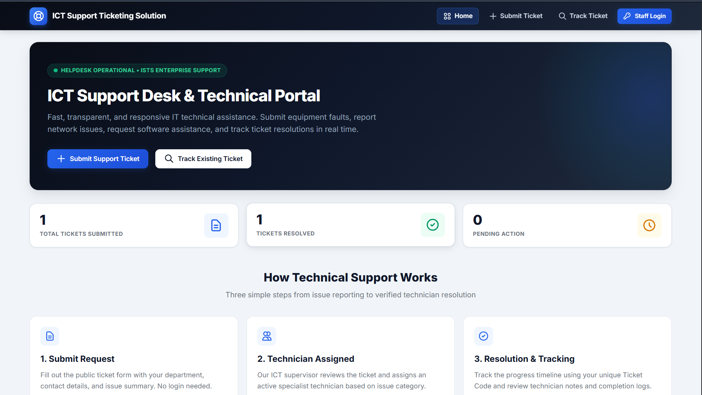
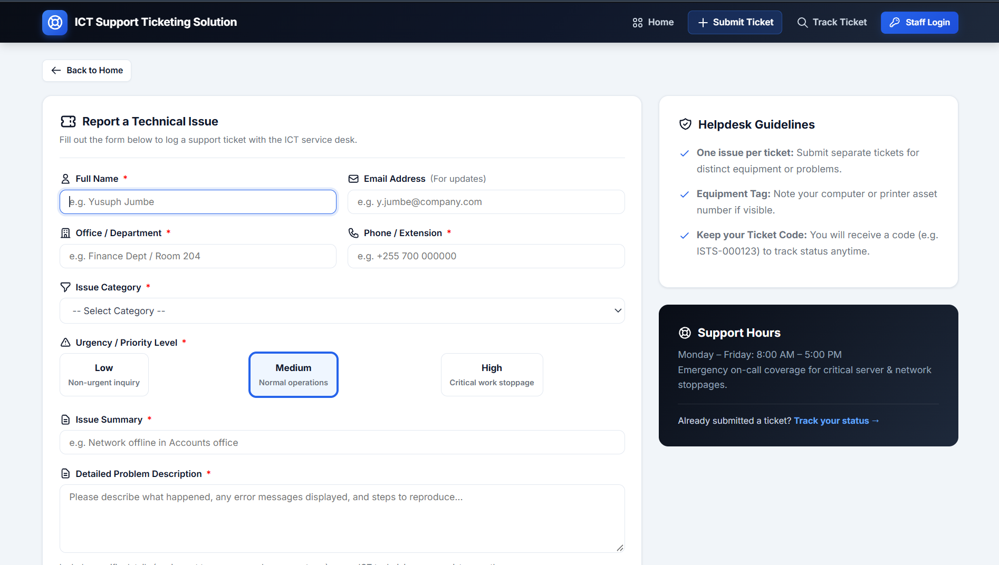
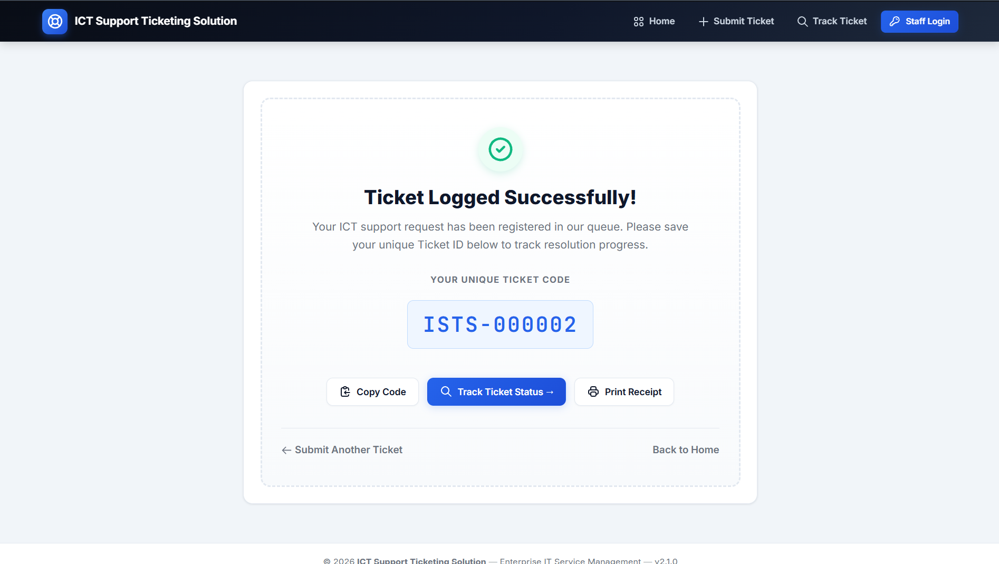
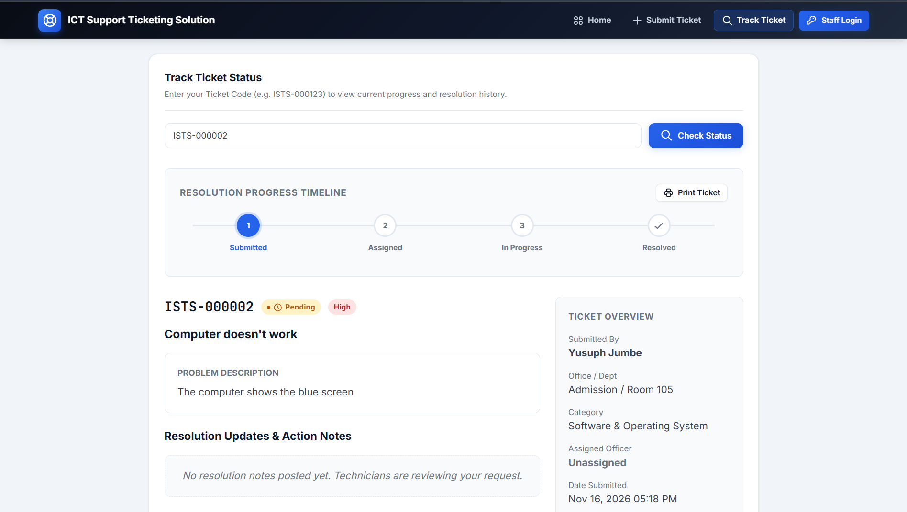
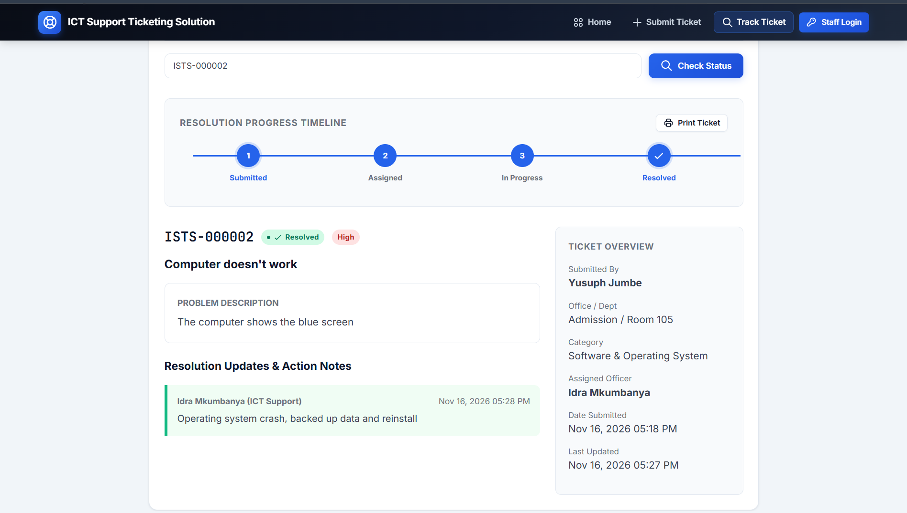
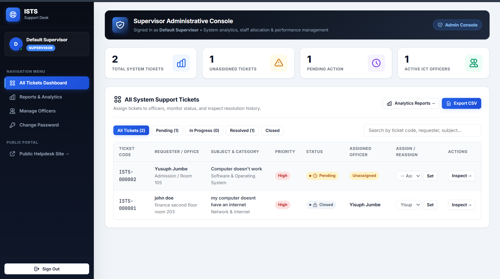
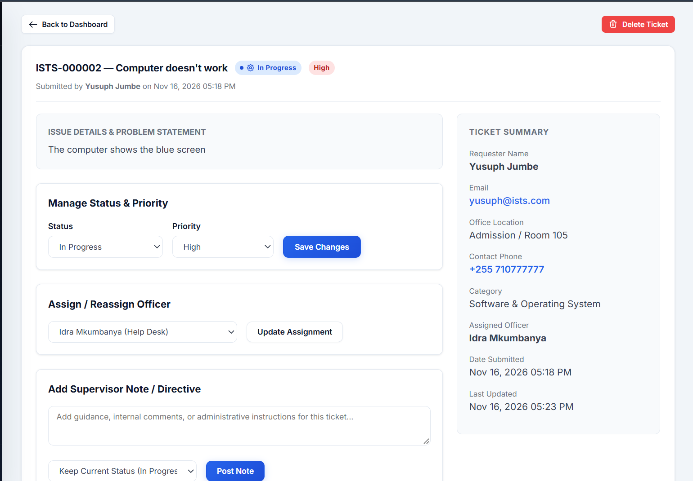
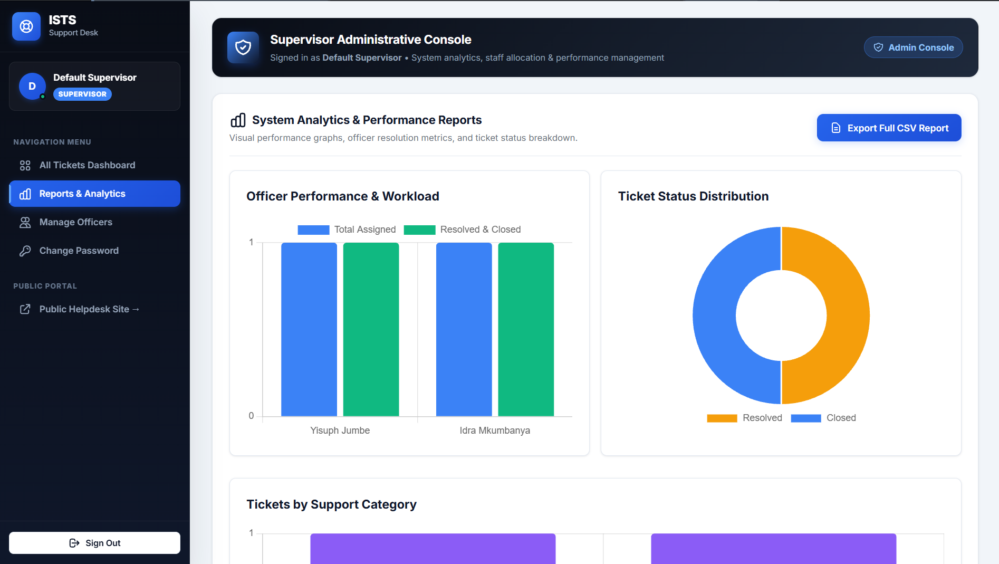
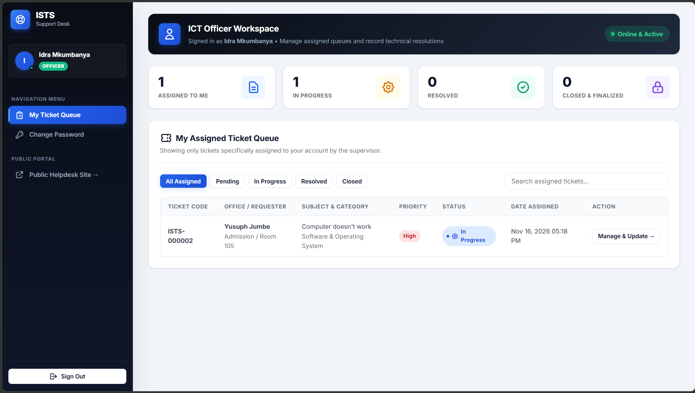

# ICT Support Ticketing Solution (ISTS)


A web-based IT help desk and incident ticketing system. Staff submit support requests without logging in, ICT supervisors assign them to technicians, and technicians record resolutions that requesters can follow in real time.

Built with plain PHP (PDO / MySQL), a custom CSS design system and inline SVG icons. No framework and no build step, so it runs on any standard XAMPP or Apache host.



---

## Table of Contents

- [Features](#features)
- [Screenshots](#screenshots)
- [Tech Stack](#tech-stack)
- [Getting Started](#getting-started)
- [Configuration](#configuration)
- [User Roles and Workflow](#user-roles-and-workflow)
- [Project Structure](#project-structure)
- [Security](#security)
- [Deploying to Production](#deploying-to-production)
- [Troubleshooting](#troubleshooting)
- [Contributing](#contributing)
- [License](#license)

---

## Features

**Public users (no login)**
- Submit a ticket with department, contact details, category and priority (Low, Medium, High)
- Receive a unique ticket code (e.g. `ISTS-000002`) with copy and print options
- Track progress on a 4-stage timeline: Submitted, Assigned, In Progress, Resolved
- Read technician resolution notes

**ICT Officers**
- Personal queue showing only tickets assigned to them
- Filter by status and search by code, requester or subject
- Update ticket status and log technical resolutions

**Supervisors**
- Dashboard of all tickets with live metrics and inline officer assignment
- Change status and priority, post directives, delete tickets
- Create, edit, activate/deactivate officers and reset their passwords
- Analytics dashboard (Chart.js) and CSV export

---

## Screenshots

### Public portal

| Submit a ticket | Ticket confirmation |
|---|---|
|  |  |

| Track status (pending) | Track status (resolved) |
|---|---|
|  |  |

### Supervisor portal



| Ticket management | Reports and analytics |
|---|---|
|  |  |

### Officer portal



---

## Tech Stack

| Layer | Technology |
|---|---|
| Backend | PHP 8.0+ (uses `str_starts_with` / `str_ends_with`) |
| Database | MySQL 5.7+ / MariaDB via PDO |
| Frontend | HTML, CSS (design tokens), vanilla JavaScript |
| Charts | Chart.js (loaded from jsDelivr) |
| Web server | Apache with `mod_rewrite` (`.htaccess` included) |

---

## Getting Started

### Requirements
- PHP 8.0 or newer with the `pdo_mysql` extension
- MySQL 5.7+ or MariaDB
- Apache (XAMPP, WAMP, LAMP or similar)

### Local installation (XAMPP)

1. **Clone the repository** into your web root:
   ```bash
   cd C:\xampp\htdocs
   git clone https://github.com/<your-username>/ists.git
   ```
2. **Start** Apache and MySQL from the XAMPP Control Panel.
3. **Create the database.** In phpMyAdmin create a database named `ists_db` (collation `utf8mb4_general_ci`), then import `sql/schema.sql`.
   Upgrading an existing v2.0 install? Run `sql/update.sql` instead.
4. **Configure the environment:**
   ```bash
   cp .env.example .env
   ```
   Edit `.env` with your database credentials (see [Configuration](#configuration)).
5. **Create the first supervisor account.** Open
   `http://localhost/ists/supervisor/setup_admin.php`, enter your name, email and a password (minimum 8 characters). The page locks itself once an admin exists.
6. **Sign in** at `http://localhost/ists/login.php`.

| Page | URL |
|---|---|
| Home | `http://localhost/ists/` |
| Submit a ticket | `http://localhost/ists/ticket_form.php` |
| Track a ticket | `http://localhost/ists/track_status.php` |
| Staff login | `http://localhost/ists/login.php` |

> The supervisor password is whatever you choose during setup. There is no default password.

---

## Configuration

All settings live in `.env` (copied from `.env.example`). Never commit `.env`.

| Variable | Default | Description |
|---|---|---|
| `APP_ENV` | auto-detected | `production` hides errors, `development` shows them |
| `APP_NAME` | ICT Support Ticketing Solution | Display name |
| `APP_TIMEZONE` | `UTC` | PHP timezone, e.g. `Africa/Dar_es_Salaam` |
| `BASE_URL` | *(empty)* | Leave empty for auto-detection, or set a subpath / full domain |
| `DB_HOST` | `127.0.0.1` | Database host |
| `DB_PORT` | `3306` | Database port |
| `DB_NAME` | `ists_db` | Database name |
| `DB_USER` | `root` | Database user |
| `DB_PASS` | *(empty)* | Database password |
| `SESSION_LIFETIME` | `3600` | Session timeout in seconds |
| `MAX_LOGIN_ATTEMPTS` | `5` | Failed logins before lockout |
| `LOGIN_LOCKOUT_MINUTES` | `15` | Lockout duration |

---

## User Roles and Workflow

```
Requester            Supervisor              Officer               Requester
   |                     |                      |                     |
Submit ticket  --->  Review and assign  --->  Work the ticket  --->  Track and read
 (Pending)            (Assigned)              (In Progress,          resolution notes
                                               Resolved)
                                                                      Supervisor may
                                                                      Close the ticket
```

| Role | Access |
|---|---|
| Public | Submit and track tickets by ticket code |
| Officer | Own queue, status updates, resolution notes, password change |
| Supervisor | Everything above plus assignment, priority, deletion, staff management, reports, CSV export |

---

## Project Structure

```
ists/
├── index.php, ticket_form.php, submit_ticket.php,
│   ticket_confirmation.php, track_status.php     Public pages
├── login.php, process_login.php                  Unified staff sign-in
├── officer/                                      Officer portal
├── supervisor/                                   Supervisor portal
├── includes/                                     Shared helpers, layout, auth guards
├── config/config.php                             Environment, sessions, base URL
├── assets/                                       CSS and JavaScript
├── sql/schema.sql, sql/update.sql                Database schema and migration
├── uploads/                                      Runtime uploads (git-ignored)
├── docs/screenshots/                             README images
├── .env.example                                  Environment template
└── .htaccess                                     Apache hardening
```

**Database tables:** `ict_officers`, `categories`, `tickets`, `resolutions`.

---

## Security

- CSRF tokens on all POST forms
- Passwords hashed with `password_hash()`
- Session fixation protection, HttpOnly / SameSite cookies, and idle timeout
- Brute-force protection with temporary lockout
- Role-based access guards on every protected page
- Prepared statements (PDO) for database access
- CSV export escapes formula-injection characters (`=`, `+`, `-`, `@`)
- Security headers (CSP, X-Frame-Options, Referrer-Policy) and an `.htaccess` that blocks `config/`, `includes/`, `sql/` and script execution in `uploads/`

Found a vulnerability? Please report it privately to the maintainer instead of opening a public issue.

---

## Deploying to Production

1. Set `APP_ENV=production` in `.env` and use a dedicated database user with a strong password (not `root`).
2. Serve over **HTTPS** so session cookies are marked `Secure`.
3. Delete any diagnostic scripts (for example `diag_check.php`) from the server.
4. After creating the admin, confirm `supervisor/setup_admin.php` is locked (or remove it).
5. Update the hard-coded `ErrorDocument` paths in `.htaccess` (`/ists/404.php`) if the app is not served from `/ists/`.
6. Keep `uploads/` writable by the web server but non-executable.
7. Back up the database regularly.

---

## Troubleshooting

| Problem | Fix |
|---|---|
| Blank page or HTTP 500 | Set `APP_ENV=development` temporarily and check the Apache/PHP error log |
| "Database connection failed" | Check `DB_*` values in `.env` and that MySQL is running |
| Redirects go to the wrong URL | Set `BASE_URL` explicitly (e.g. `/ists`) |
| Locked out after failed logins | Wait `LOGIN_LOCKOUT_MINUTES`, or clear the rate-limit session/IP record |
| Need a second admin | Add a supervisor-role officer from **Manage Officers** |

---

## Contributing

1. Fork the repository and create a branch: `git checkout -b feature/short-description`
2. Make focused commits using [Conventional Commits](https://www.conventionalcommits.org/) (`feat:`, `fix:`, `docs:`)
3. Open a pull request describing what changed and how you tested it

---

## License

Released under the [MIT License](LICENSE).
